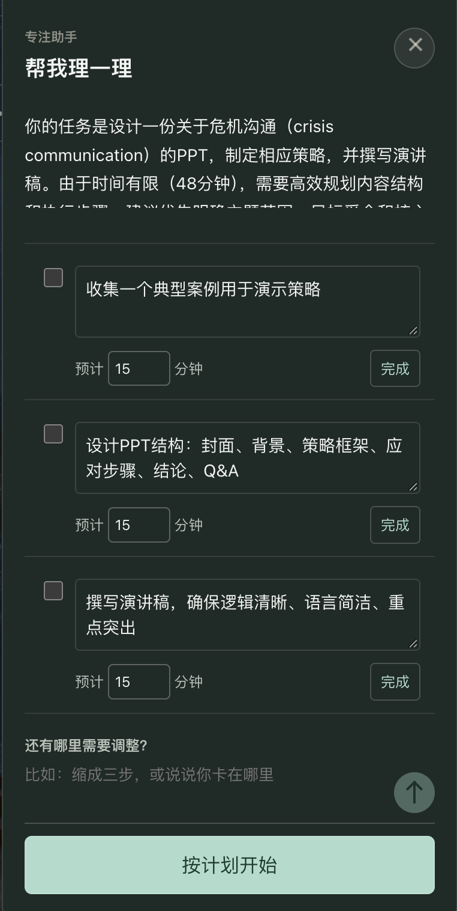
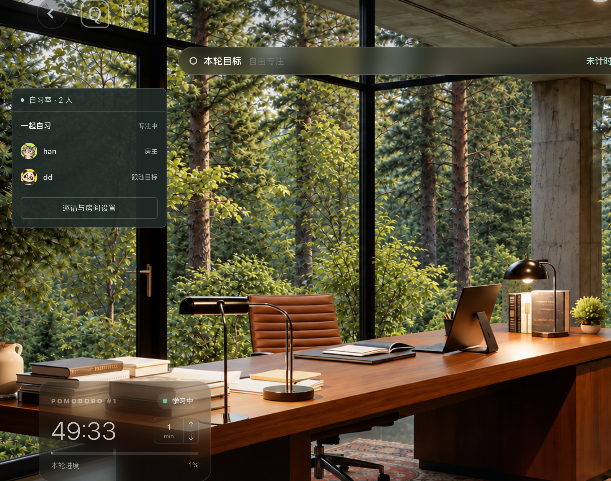
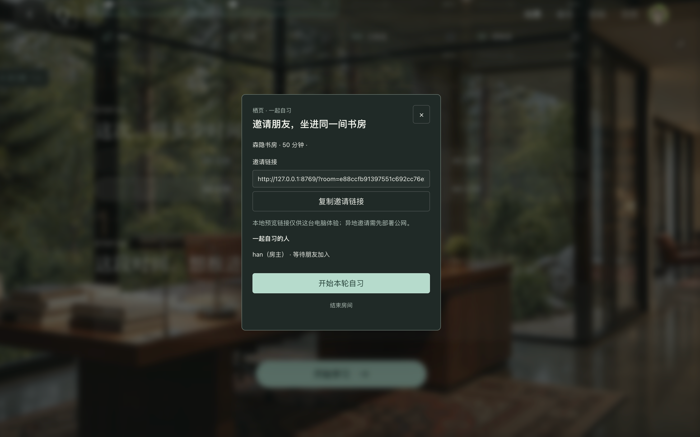
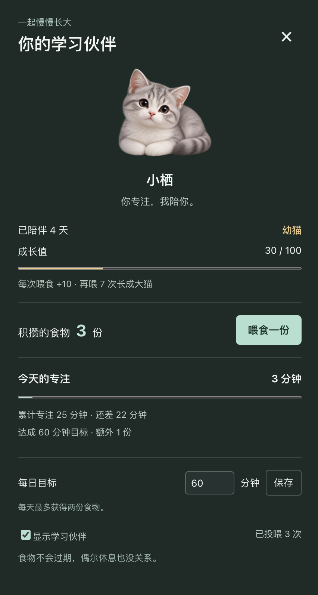

# Qiye | 栖页

An AI-powered virtual study room for people who find it hard to get started. This independently developed MVP connects task planning with focused execution, reducing the effort of manually breaking down goals and creating to-do lists before studying.

> Portfolio MVP with local and cloud runtime modes. Screenshots show the developer's local version. Cloud deployment verification is in progress; this repository URL is not itself a live demo. Selected runtime images are included; audio recordings and secrets are not.


## Product Approach

Designed for exam preparation, assignments, academic writing, and independent learning, Qiye turns broad goals into actionable steps. AI proposes a plan; users decide whether to adopt it. Generating a plan does not automatically start execution.

Core flow: **Describe a goal → Generate an AI plan → Review and adjust → Work through tasks with timers**.

- **AI task planning**: Break down natural-language goals into a to-do list with estimated durations. Edit task content, timing, and order.
- **Focus environment**: Choose study scenes, mix ambient sounds, use a Pomodoro timer, and track study sessions.
- **Shared study rooms**: Invite friends, follow the host's goal or keep a personal goal, and synchronize shared goals, task lists, and goal countdowns.
- **Study companion**: Track days together and feed a virtual pet to support its growth.

## Product Walkthrough

### Set Up Your Environment and Goal

Choose a study scene, customize background music and ambient sounds, and set a session duration and goal. Start directly or ask AI to plan the session first.


<details>
<summary>View sound settings, session duration, and the AI planning entry point</summary>

**Sound settings**: Adjust music and ambient volume separately, combine environmental sounds, and control individual sound levels.


**Session setup and AI planning**: Select a duration and optionally enter a goal. Users can start studying directly or select "Plan these 50 minutes" to turn the goal into an AI-generated plan. The planning entry point reflects the selected session duration. Review and adjust the plan before starting.


</details>

### Turn a Broad Goal into an Actionable Plan

Describe a task in natural language and receive suggested steps. Edit the content and estimated durations, then choose "Start with this plan."


<table>
  <tr><th>Task breakdown and plan review</th><th>Additional steps and adjustments</th></tr>
  <tr>
    <td width="50%"></td>
    <td width="50%"></td>
  </tr>
</table>

### Move from Planning to Focused Work

The confirmed plan becomes a to-do list. Reorder tasks, select the current task, and track both the goal countdown and the Pomodoro timer.


<details>
<summary>View the rainy library focus screen</summary>


</details>

### Study Together

Create a room and invite friends. Members can follow the host's goal or keep their own goals.



<details>
<summary>View invitations and room settings</summary>



The `127.0.0.1` address in this screenshot is a local demo address, not a public invitation link.

</details>

### A Study Companion

Track days spent together and earn food through focused study. Feeding increases the pet's growth value, providing lightweight feedback on study activity.



## AI Workflow

Local mode uses Ollama; cloud mode uses a fixed Doubao model through a server-side API. The model generates a structured plan; the application validates fields and steps and uses a deterministic time-allocation tool to constrain the total duration. It supports clarification when context is insufficient. User confirmation is required before execution. Cloud AI requires sign-in and has shared daily request limits. Provider-side free-quota auto-pause must remain enabled; application request limits are not billing caps.

This is a controlled planning workflow, not a general-purpose autonomous agent with unrestricted actions. It currently has no knowledge-base retrieval or web search capabilities, and improved learning efficiency has not been validated.

See [Agent Design](AGENT-DESIGN.md) for the detailed design. The core implementation is in `focus-agent.mjs`.

## Run Locally

Requirements: Node.js 24 and a running Ollama instance with a model installed.

1. Copy `.env.example` to `.env` and set `LOCAL_MODEL` to the name of an installed model.
2. Run this command from the project root:

```sh
node --env-file=.env server.mjs
```

3. Open the address printed in the terminal. The default is `http://127.0.0.1:8766/`.

On macOS, you can also run `zsh start-local.command`, which defaults to port 8769. The regular interface can run without a configured model, but AI planning will be unavailable. Local mode accepts local connections only. GitHub Pages cannot run this backend.

## Cloud Deployment

The cloud runtime targets Vercel with Supabase Postgres and Volcano Ark. Run `npm ci` and `npm run build`. Configure server-only environment variables using `.env.cloud.example`; never commit real values. Follow [Cloud Setup](docs/CLOUD-SETUP.md) for database migration, verified TLS, credentials, and deployment checks.

## Architecture

| Path | Responsibility |
| --- | --- |
| `outputs/study-room-mvp/` | HTML, CSS, and JavaScript frontend |
| `server.mjs` | Static files and same-origin APIs |
| `focus-agent.mjs` | Prompts, structured output validation, and time allocation |
| `auth.mjs` | Local SQLite accounts and sessions |
| `rooms.mjs` | Shared study rooms and state synchronization |
| `cloud-auth.mjs`, `cloud-rooms.mjs`, `database.mjs` | Postgres-backed cloud accounts, sessions, rooms, and request limits |
| `api/index.mjs`, `vercel.json`, `build.mjs` | Serverless API routing and allowlisted static build |

Development was primarily assisted by Codex. Ollama provides local model inference.

## Tests

Core tests that do not require a live model:

```sh
node --test server.test.mjs auth.test.mjs rooms.test.mjs ai-errors.test.mjs focus-agent.test.mjs companion-store.test.cjs companion-ui.test.mjs goal-clock.test.cjs calendar-store.test.cjs together.test.mjs task-order.test.mjs
```

`scene-effects.test.mjs` still references image-testing dependencies on the development machine and is excluded from the portable command above. Run live model evaluations separately with `node --env-file=.env agent-eval.mjs`. Passing automated tests does not establish model quality or readiness for secure public deployment.

## Current Limitations

- Local registration and sign-in are supported, but email or phone verification and password recovery are not. Use test identities; do not collect sensitive real-user information.
- Study records are stored in the browser. They do not sync with accounts and are not isolated by account.
- Local rooms are stored in server memory. Cloud rooms use Postgres with a 24-hour lifetime; mutations are serialized for this small demo, not optimized for high traffic.
- Public deployment verification is still pending. This is a portfolio demo, not a production-ready service.

## Assets and Privacy

Audio files, private runtime data, and secrets are excluded from this repository. `docs/screenshots/` contains only screenshots selected by the project author for the product showcase, not reusable original scene assets. Users must supply local audio files they have the right to use. YouTube background music relies on a third-party service and does not imply permission to redistribute that music. Ambient sounds include browser-synthesized audio.

Rights to scene images, avatars, and other visual assets must be checked separately. This repository does not grant reuse or redistribution rights to third-party assets. Existing third-party license files are retained; no project-wide open-source license has been added.
